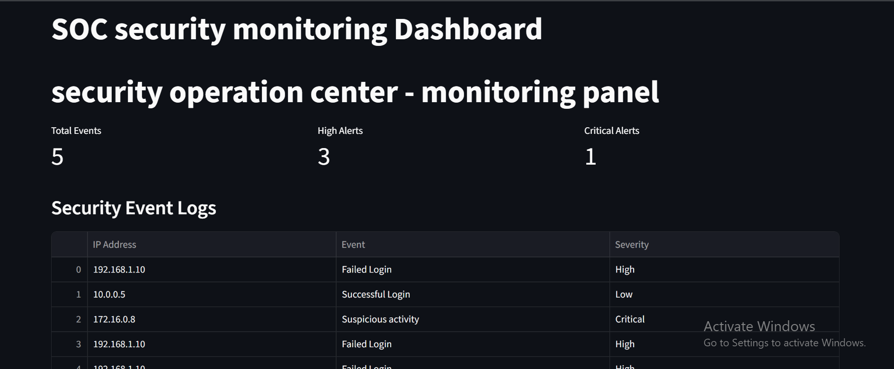

# SOC Security Monitoring Dashboard
## Project overview
A python-based security Operations center (SOC) monitoring dashboard built using stream lit and pandas. This project demonstrates security log analysis, alerts visualization, suspicious IP detection, and basic brute-force attack detection using sample data.
## Technologies Used
- Python
- Stream lit
- Pandas
- CSV Log Analysis
- GitHub
## Key Features
- Security event log monitoring
- High and critical severity alert tracking
- Suspicious IP address detection
- Failed login and possible brute-force detection
- Security event visualization
- Basic security risk scoring
- CSV security report export
## Installation
```bash
pip install -r requirements.txt
stream lit run dashboard.py
```
## Project Files
- `dashboard.py` - Dashboard application
- `security_logs.csv` - sample security events
- `SOC_security_report.csv` - Example exported report
- `requirements.txt` - python dependencies
## Security Disclaimer
This project is for educational and portfolio purposes. Detection logic is based on sample security logs and is not a production-ready SIEM solution.
## Dashboard screenshot

## Live Demo
[View SOC Monitoring Dashboard](https://u5xbn6rtmd5ppcftu9akid.streamlit.app/)
